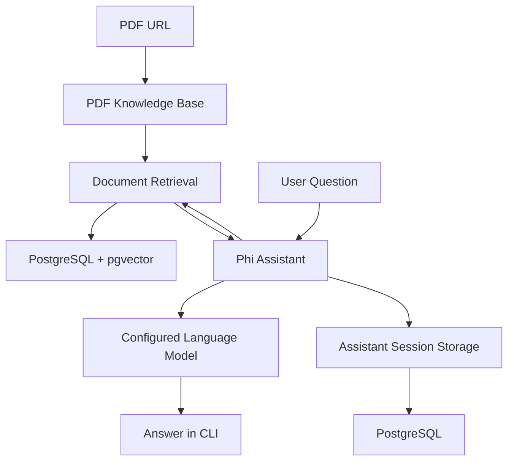

# 📄 PDF Knowledge Assistant — RAG-Based Document Q&A

A conversational assistant that lets users query information from a PDF through natural-language questions. The project combines document knowledge retrieval, vector search, persistent conversation storage, and an interactive command-line interface.

Built with Python, the Phi Assistant framework, PostgreSQL, and pgvector, the application demonstrates a practical approach to building a retrieval-augmented question-answering system over document-based knowledge.

## ✨ Features

- **PDF knowledge ingestion:** Loads a PDF from a URL into a searchable knowledge base.
- **Retrieval-augmented question answering:** Enables the assistant to search the knowledge base when responding to user queries.
- **Vector database integration:** Uses PostgreSQL with pgvector through the `PgVector2` integration.
- **Persistent conversations:** Stores assistant sessions and conversation history in PostgreSQL.
- **Session resumption:** Retrieves an existing conversation for a user or starts a new session.
- **Conversational context:** Enables the assistant to access previous chat history.
- **Tool-call visibility:** Enables visibility into the assistant's tool calls.
- **Command-line interface:** Uses Typer to expose the assistant as an interactive CLI application.
- **Markdown responses:** Runs the CLI in Markdown mode for readable output.

## 🧠 How It Works

The application follows a document retrieval and conversational question-answering workflow.

1. **Load the PDF:** A remote PDF is configured as the source of knowledge.
2. **Prepare the knowledge base:** The PDF knowledge-base integration loads document content into the configured vector database.
3. **Retrieve relevant information:** The assistant is configured to search its knowledge base when answering questions.
4. **Generate responses:** The assistant uses its configured language-model integration to respond to queries.
5. **Maintain conversation history:** PostgreSQL-backed assistant storage persists conversations between sessions.
6. **Resume or start a session:** The CLI can continue an existing run for a user or create a new one.

## 🏗️ Architecture



## 🛠️ Tech Stack

| Technology | Purpose |
|---|---|
| Python | Application logic |
| Phi Assistant | Assistant orchestration and knowledge-base integration |
| PDFUrlKnowledgeBase | Loads PDF content from a URL |
| PostgreSQL | Persistent storage |
| pgvector | Vector database integration |
| Typer | Command-line interface |
| python-dotenv | Environment variable loading |
| Psycopg | PostgreSQL connectivity |

## 📁 Project Structure

```text
pdf-knowledge-assistant/
├── pdf_assistant.py
├── .env
├── .gitignore
├── requirements.txt
└── README.md
```

The current implementation is contained primarily in `pdf_assistant.py`. The supporting files are recommended for dependency management and configuration.

## 🚀 Getting Started

### Prerequisites

- Python
- A reachable PostgreSQL instance configured for the application's vector database integration
- The PostgreSQL/pgvector dependencies required by the chosen Phi Assistant version
- A configured language-model provider and its credentials

### 1. Clone the repository

```bash
git clone https://github.com/YOUR_USERNAME/pdf-knowledge-assistant.git
cd pdf-knowledge-assistant
```

Replace `YOUR_USERNAME` with your GitHub username and adjust the repository name if necessary.

### 2. Create a virtual environment

```bash
python -m venv .venv
```

Activate it on Windows:

```powershell
.venv\Scripts\Activate.ps1
```

Activate it on macOS or Linux:

```bash
source .venv/bin/activate
```

### 3. Install dependencies

Install compatible versions of the packages used by the project:

```bash
pip install phidata typer python-dotenv "psycopg[binary]" pgvector
```

The exact dependencies may vary by Phi Assistant version and configured model provider. Pin the versions that you verify in your working environment.

### 4. Configure environment variables

Create a `.env` file:

```env
GROQ_API_KEY=your_groq_api_key
```

Do not commit API keys or other credentials to GitHub.

The database connection is currently defined in the Python source as:

```python
postgresql+psycopg://ai:ai@localhost:5532/ai
```

Make sure PostgreSQL is reachable with the configured database, username, password, host, and port. For deployment, move this URL into an environment variable rather than keeping credentials in source code.

**Model configuration note:** The current script loads `GROQ_API_KEY`, but it does not explicitly pass a Groq model to the `Assistant` constructor. Configure the intended language model using the API supported by your installed framework version before assuming that inference is running through Groq.

### 5. Run the assistant

Rename the script to `pdf_assistant.py` if needed, then execute:

```bash
python pdf_assistant.py
```

The application uses Typer to launch the assistant's CLI.

To create a new conversation instead of resuming the existing session, use the `--new` option supported by the declared `new` parameter. You can also specify a user identifier using the `--user` option.

## 📚 Current Document Source

The uploaded implementation uses a sample Thai recipes PDF:

https://phi-public.s3.amazonaws.com/recipes/ThaiRecipes.pdf

The PDF URL is hardcoded in the source. To use another document, configure the desired accessible PDF URL in the knowledge-base initialization and verify that it loads and indexes successfully.

The current code does not yet provide a web-based PDF upload interface.

## 💾 Conversation Persistence

The application uses `PgAssistantStorage` with the `pdf_assistant` table to persist assistant sessions.

When the application starts, it attempts to retrieve an existing run for the selected user. If a run is available and a new session was not requested, it resumes that conversation. Otherwise, it initializes a new run.

This supports a stateful, multi-turn command-line interaction instead of treating every question as an isolated request.

## 🔒 Security and Reliability Considerations

Before deploying the application publicly:

- Store database URLs and API keys in environment variables or a secrets manager.
- Explicitly validate required configuration values at startup.
- Configure the intended LLM provider and handle provider errors.
- Restrict database permissions and use secure credentials.
- Add error handling for failed PDF downloads, parsing errors, and vector database connection failures.
- Pin dependencies and document the supported Python and PostgreSQL versions.
- Avoid committing `.env` files or generated secrets to version control.

## 🔮 Future Improvements

- Support user-uploaded PDF files.
- Add a web interface using FastAPI or Streamlit.
- Display source passages and page references for answers.
- Add retrieval evaluation and answer-quality tests.
- Support multiple documents and selectable knowledge bases.
- Add document-level access controls for multiple users.
- Implement structured logging and production deployment configuration.

## 📚 References

- [Phi / Phidata documentation](https://docs.phidata.com/)
- [PostgreSQL documentation](https://www.postgresql.org/docs/)
- [pgvector](https://github.com/pgvector/pgvector)
- [Typer documentation](https://typer.tiangolo.com/)
- [python-dotenv](https://github.com/theskumar/python-dotenv)

---

**Project focus:** Document retrieval, conversational AI, vector databases, and persistent assistant sessions.
